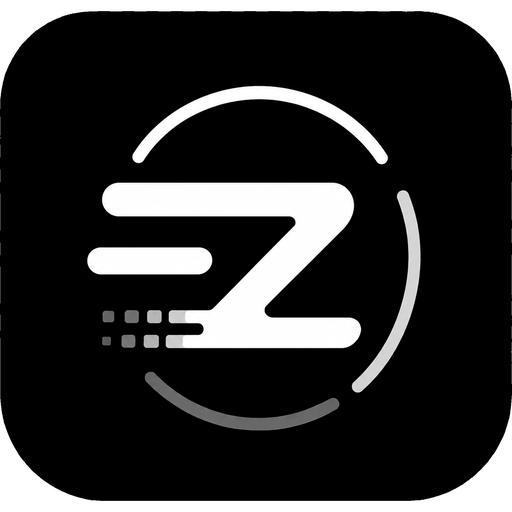

# EZSTARTAgentDSH

EZSTART Agent 的 DeepSeek Harness 插件：把 DSH 侧边栏品牌改成 **deepseek EZAgent**，在左侧菜单底部加 **EZCloud 账号入口**，并把 EZCloud 接入 DSH 的模型选择器与账户面板。

登录后：

- DSH 模型选择器里出现 **EZCloud** 分组，列出该账号当前可用的模型；未登录时该分组不存在。
- 账号弹窗显示钱包余额、订阅状态、5 小时/每周/每月额度、计费方式与 API 密钥。



## 功能

- **侧边栏账号入口**：固定在底部、设置按钮上方。未登录显示「登录」，已登录显示账号名与首字母头像。
- **EZCloud 登录**：账号 + 密码，自动识别手机号或用户名；登录后自动签发（或复用）名为 `EZAgent` 的长期密钥。
- **EZCloud 模型接入**：宿主端注册 `ezcloud` provider，`listModels()` 只在该账号登录后返回其可用模型（来自 `/api/user/self/models`，并与 `/api/pricing` 合并出厂商、上下文、输入模态、单价）。未登录时返回空列表，DSH 会把空分组从选择器里过滤掉，因此**不登录就看不到**。
- **流式对话**：`POST /v1/chat/completions`（OpenAI 兼容，SSE），支持文本增量、推理增量、工具调用、用量统计与错误码映射。
- **账户详情**：钱包余额（E 额度）、已用额度、请求数、订阅套餐（名称/等级/到期时间）、三档额度进度条、计费方式切换、密钥复制、退出登录。
- **模型只在选择器里选**：账号弹窗只读展示该账号可用的模型，并显示 DSH 模型选择器当前实际暴露的 EZCloud 模型数量；真正的模型切换统一在输入框的模型选择器里完成。
- **登录态持久化**：会话存在浏览器 `localStorage`，刷新页面或重启应用后由页面自动向宿主端同步，模型分组随之恢复。
- **品牌更名**：侧边栏 wordmark 显示为 `deepseek EZAgent`。

## 分发与安装

插件不发布到公共 npm，分发物是一个 tgz（只含插件自己的 6 个文件，不含 `node_modules`）。使用者在自己机器上安装。

### 使用者：安装

**方式一：双击 install.bat（推荐，不需要命令行）**

1. 把 `install.bat`、`install.ps1`、`EZAgent-<version>.tgz` 放在同一个文件夹。
2. 完全退出 DeepSeek Harness（托盘图标也要退出）。
3. 双击 `install.bat`，按窗口提示走完。
4. 启动 DeepSeek Harness。

窗口会停留到按任意键，报错可以直接截图反馈。

**方式二：图形界面**

1. 打开 DeepSeek Harness，左侧「插件」→「添加插件」。
2. 粘贴 tgz 的绝对路径，例如 `C:\Users\you\Downloads\EZAgent-<version>.tgz`（把 `<version>` 换成实际版本号）。
3. 需要时再按包名添加公开插件（见下方「公开插件」）。
4. 重启 DeepSeek Harness。

**方式三：命令行**

把 `install.ps1` 和 `EZAgent-<version>.tgz` 放同一目录，完全退出 DeepSeek Harness 后：

```powershell
powershell -ExecutionPolicy Bypass -File .\install.ps1
```

只装 EZAgent、不联网安装公开插件：

```powershell
powershell -ExecutionPolicy Bypass -File .\install.ps1 -LocalOnly
```

脚本依次检查 tgz 是否存在、DSH 桌面版配置是否已初始化、应用是否已退出、`dsh` 命令是否可用；没有 `dsh` 时打印图形界面步骤。装完读取 profile 的 `dsh.profile.bundles` 确认已启用。

> 安装后 `%USERPROFILE%\.dsh\profiles\desktop\package.json` 的 `dependencies` 与 `dsh.profile.bundles` 都会出现 `EZAgent`，无需手工编辑。

### 维护者：发版

```powershell
# 1. 改 package.json 的 version
# 2. 打包
npm run pack
```

产出 `dist/`：`EZAgent-<version>.tgz` + `install.ps1` + `install.bat`，把整个目录压缩发给使用者即可。`npm run pack` 每次先清空 `dist`，保证里面只有当前版本；tgz 内容由 `files` 白名单决定。

### 公开插件

安装脚本默认还会从 npm 源下载两个公开插件（不随 tgz 分发）：

| 包 | 版本 | 说明 |
| --- | --- | --- |
| `dsh-mnemon` | 0.5.39 | 可组合记忆 |
| `@huanlin/dsh-plugin-better-sidebar-plugin-office` | 0.2.0 | Office 预览；需要 `dsh-better-sidebar` |

离线机器用 `-LocalOnly` 跳过，或改用插件页按包名手动安装。

### 开发调试

把本仓库链接进 profile，改 `client.js` 后刷新页面即可看到效果：

1. 把本仓库克隆（或链接）到任意目录，例如：

   ```powershell
   git clone https://github.com/YeshengSu/EZSTARTAgentDSH "$HOME\Documents\deepseek-harness\default-workspace\EZAgent"
   ```

2. 在 DSH 配置档（`%USERPROFILE%\.dsh\profiles\desktop\package.json`）中加入链接依赖与 bundle 条目：

   ```json
   {
     "dependencies": {
       "EZAgent": "link:C:/Users/<you>/Documents/deepseek-harness/default-workspace/EZAgent"
     },
     "dsh": {
       "profile": {
         "bundles": ["...", "EZAgent"]
       }
     }
   }
   ```

3. 重启 DeepSeek Harness。

> 宿主角色的代码（`index.js`）只在应用启动时加载，改动后必须重启；只改 `client.js` 时刷新页面即可。

## 使用

1. 点击左侧菜单最下方的入口，输入账号与密码登录。
2. 模型选择器里选择 **EZCloud** 下的任一模型，即可对话。
3. 再次点开入口可查看余额 / 订阅 / 额度，切换计费方式，复制密钥或退出登录。

### 选择器里的 EZCloud 增强

选中 EZCloud 模型后，模型菜单会多出两样东西：

- **推理等级**：`Low / Medium / High / Max`，默认 High。只有这四个值会被写进请求的 `reasoning_effort`。实测（api.ezstartai.com）：`low|medium|high|max` 会保持请求的模型，`none|minimal|ultra` 会被**静默换成 deepseek-flash**，`off` 直接 422；也没有真正的「关闭」——不传该字段时模型仍按自己的自适应策略思考（实测 Claude-Opus-5 仍产生 95 个 reasoning tokens），所以不提供 Off 档。
- **E 消耗徽标与悬停卡**：行右侧只显示数字 `E 2,400`——token 计费模型是每 100 万 token 的均价，按次计费模型是每次调用价，单位写在悬停卡里；悬停展开供应商、模型介绍、输入 / 输出 / 缓存读取 / 缓存写入单价与单位说明。价格由 `/api/pricing` 的 `billing_expr` 系数（美元 / 1M token）按 `credits_per_usd` 换算成 E，不用后端那几个占位性质的 `credits` / `avg_credits` 字段。

这两样都走 DSH 自己的扩展点（`reasoning.efforts` 与 `conversation.input.model.label`），不替换内置选择器，所以 DSH 更新选择器时会自动跟随。未登录、目录读取失败或价格字段缺失时，选择器退回只显示模型名，不会报错。

> `conversation.input.model.label` 是单选席位，官方内置的 `DeepSeek-V4.1-Flash` 发布标记插件也占用它。本插件用更低的 priority 取得该席位，因此那个「1017」发布标记不再显示；其余非 EZCloud 模型渲染结果与原来一致（纯模型名）。

## 架构

```
EZAgent/
├─ client.js          # 浏览器半端：侧边栏入口、登录与账户弹窗、本地登录态
├─ index.js           # 宿主半端：EZCloud 路由 + LlmAdapter（ezcloud provider）
├─ cordis.patch.yml   # 把插件挂进 DSH 插件树
├─ package.json       # 插件清单（dsh.client / dsh.bundle）
└─ icon.png           # 插件图标
```

**为什么请求要走宿主端？** 线上 EZCloud 只在 `OPTIONS` 预检里返回 `Access-Control-*`，真实响应没有这些头，浏览器里任何跨域 `fetch` 都会失败。因此浏览器半端不发请求给 EZCloud，而是调用插件宿主端的同源路由：

```
页面 fetch('ezagent/ezcloud/account')
  └─ dsh-app://app/ezagent/ezcloud/account
       └─ 桌面外壳转发到宿主 HTTP 服务（同源）
            └─ index.js: GET https://api.ezstartai.com/api/user/self
```

宿主端路由：

| 路由 | 方法 | 作用 |
| --- | --- | --- |
| `/ezagent/ezcloud/sign-in` | POST | 账号密码登录，返回 `{ok:true, session:{…, apiKey}}` |
| `/ezagent/ezcloud/sign-out` | POST | 撤销 device key，返回 `{ok:true, result:{revoked}}` |
| `/ezagent/ezcloud/sync` | POST | 页面加载时把本地会话同步给宿主端（宿主端只存内存） |
| `/ezagent/ezcloud/account` | POST | 聚合余额、订阅、额度与计费方式 |
| `/ezagent/ezcloud/models` | POST | 当前账号可用的模型列表（含刷新） |
| `/ezagent/ezcloud/billing-preference` | POST | 修改计费优先级（`subscription_first` 等） |
| `/ezagent/ezcloud/diagnostics` | POST | 宿主健康检查（模型 provider 是否注册、llm 服务是否可见） |

模型接入走 DSH 的 LLM 服务：

```js
ctx.llm.registerAdapter([{ id: 'ezcloud', name: 'EZCloud' }], new EzCloudAdapter(ctx));
```

`EzCloudAdapter` 实现 `listModels` / `resolveModel` / `stream`：

- `listModels()` 未登录返回 `[]`（分组自动消失），登录后返回账号可用模型。
- `resolveModel()` 从 `/api/pricing` 的描述里解析上下文长度（如「1.05M 上下文」），解析失败时按模型名启发式估计，并给出 `defaultMaxTokens` 上限。
- `stream()` 把 DSH 消息转成 OpenAI Chat Completions 请求，逐块翻译 SSE：`text_delta`/`reasoning_content`/`tool_calls`/`usage`/`finish_reason`。

宿主端路由只接受 `POST`、请求体上限 64 KiB、20 秒超时，并在 `connection` 服务可用时复用其同源校验拒绝跨站调用。失败统一返回 `{ok:false, error:{code, message}}`。

## 登录态与本地数据

浏览器 `localStorage` 的 `ezagent.ezcloud.session.v1` 保存：

- `apiKey` / `apiKeyId` / `apiKeyName` —— 判断是否登录的唯一依据
- `username` / `displayName` / `userId` / `group` —— 仅用于界面展示
- `deviceKey` —— 调用 dashboard 接口与退出登录时撤销

**不保存** dashboard 的 `access_token` 与 session id：它们只在宿主端登录过程中使用，不进浏览器存储。

宿主端还会把当前会话镜像到 `%USERPROFILE%\.dsh\ezagent-session.json`（权限 0600），这样重启 DSH 后、页面尚未重新同步前，模型选择器也能立刻拿到 EZCloud 模型；退出登录会删除该文件。

## 安全说明

- 账号密码只在一次登录请求中出现，交给宿主端后立即用于 EZCloud 认证，不落盘、不回显。
- 密钥以明文存在本机 localStorage 与宿主端内存，用于调用 EZCloud；退出登录会清空本地会话并撤销 device key。
- 宿主端路由默认同源可用；`connection` 服务存在时，跨站请求会被 403 拒绝。
- 尚未实现：二次验证（2FA）账号会收到明确提示并中止登录；套餐购买/升级仍需到 EZCloud 网页端完成。

## 常见问题

**登录后模型选择器里没有 EZCloud**

先看宿主端诊断日志 `%USERPROFILE%\.dsh\ezagent-diag.log`：`adapter registered` 表示 provider 已注册，`listModels: N models` 表示目录已返回 N 个模型（N 为 0 时是会话或接口问题）。日志超过 32 KB 会自动清空。

> 1.4.2 修复：此前注册使用了 `[{ id, name }]`，而 `llm.registerAdapter(providers, adapter)` 接收的是 provider **id 字符串数组**，宿主因此每次都抛 `adapter metadata for provider "[object Object]" ...`，provider 从未进入注册表，选择器自然没有分组。升级后日志里应出现 `adapter registered`。

宿主的路由/SDK 层与账号无关的部分仍可用 `/ezagent/ezcloud/diagnostics` 自查：`registered` 为 provider 是否注册、`registeredProviders` 为注册表里实际的 provider id 列表、`adapterError` 为失败原因。


宿主的模型分组依赖登录会话。确认账号弹窗能正常显示余额（说明会话有效），必要时点开弹窗里的「刷新模型」；仍不出现时重启 DSH 再试。

**点登录后提示「无法连接 EZCloud 服务，请检查本机网络」**

宿主端拿不到请求：确认已重启 DSH（宿主端代码需要重新加载），并检查本机能否访问 `https://api.ezstartai.com`。

**提示「该账号已开启二次验证」**

当前版本不支持 2FA 账号，请先在 EZCloud 网页端关闭二次验证，或换用未开启 2FA 的账号。

**左侧菜单没有入口**

确认 profile 的 `package.json` 已包含 `EZAgent`，且侧边栏底部区域没有被其它插件占用；重启应用后再看。

## English

A DeepSeek Harness plugin for EZSTART Agent. It rebrands the sidebar wordmark to **deepseek EZAgent**, adds an **EZCloud account entry** at the bottom of the left menu, and wires EZCloud into DSH as a model provider.

After signing in, an **EZCloud** group appears in the model picker with the models your account can use; the group is absent while signed out because the adapter reports an empty catalog. The account dialog shows wallet balance, subscription status, the 5-hour/weekly/monthly quota bars, billing preference, and the API key.

The browser half never calls EZCloud directly — the deployed gateway omits CORS headers on real responses — so every call is proxied through the plugin's host half at `/ezagent/ezcloud/*`. Chat traffic streams through the plugin's own `LlmAdapter` against the OpenAI-compatible endpoint. Only the API key, account labels, and the revocable device key are kept in local storage; the dashboard access token is not persisted.

Distribution is a `.tgz` built with `npm run pack` (output in `dist/`, shipped together with `install.ps1`). Users install it from the plugin page by pasting the absolute path, or run `install.ps1` with DeepSeek Harness fully closed; the script also installs two public plugins from npm unless `-LocalOnly` is passed. For development, link the repository into your DSH profile's `dependencies` and add it to `dsh.profile.bundles` instead, then restart DeepSeek Harness.

## License

未附带许可证文件；如需对外分发，请先与仓库所有者确认授权方式。
